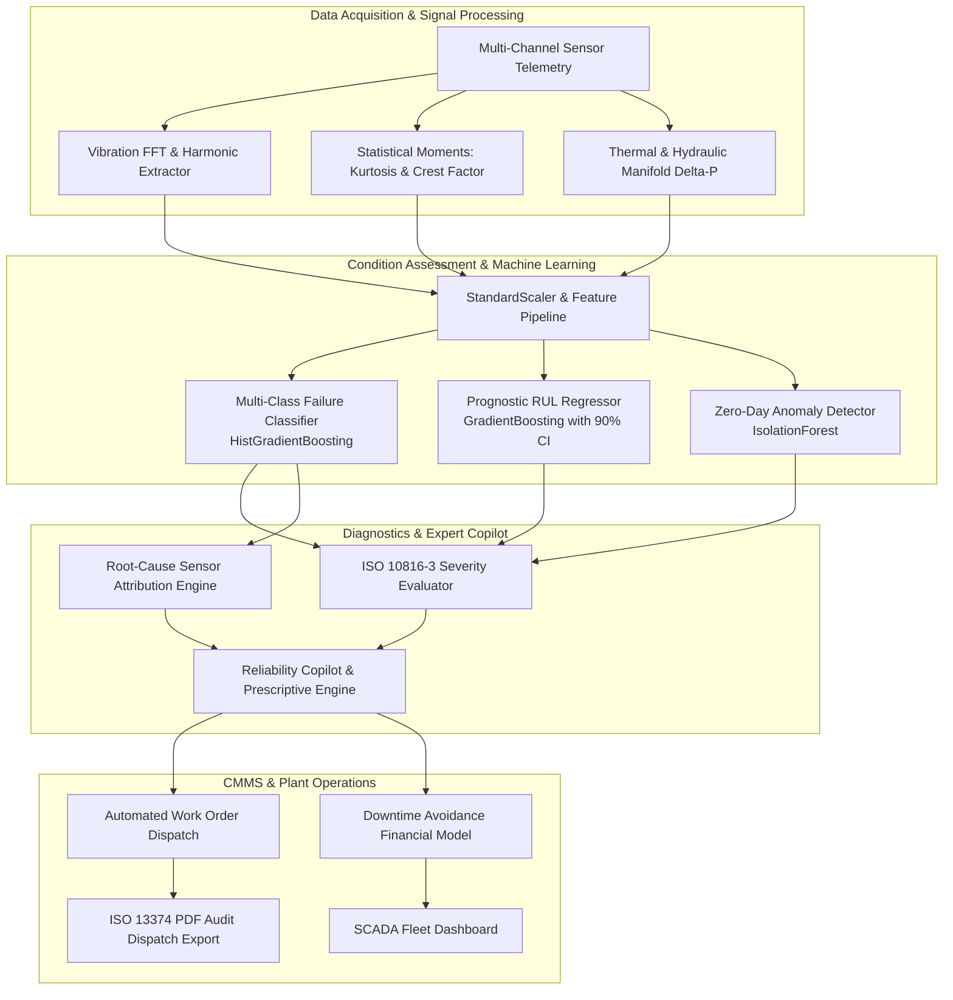

# AuraVibe IIoT: Plant Asset Health Monitoring & Predictive Maintenance Copilot

[](https://www.python.org/)
[](https://opensource.org/licenses/MIT)
[](https://www.iso.org/)
[](https://www.iso.org/)
[](tests/)

An industrial condition monitoring and prognostic reliability platform for critical rotating machinery. Combines high-frequency vibration signal processing, multi-class failure classification, Remaining Useful Life (RUL) regression, and an automated Computerized Maintenance Management System (CMMS) copilot with ISO 10816-3 compliance.

---

## 1. System Architecture

The platform follows the **ISO 13374 (Condition Monitoring and Diagnostics of Machine Systems)** open system architecture, separating telemetry acquisition, state detection, health assessment, prognostic forecasting, and advisory generation into decoupled pipelines:



---

## 2. Engineering Formulations & Standards

### 2.1 ISO 10816-3 Vibration Severity Classification
Vibration velocity RMS ($v_{\text{rms}}$) across $10\text{ Hz}$ to $1000\text{ Hz}$ is evaluated for Class II and Class III industrial machines ($15\text{ kW} \le P \le 300\text{ kW}$) mounted on rigid foundations:

$$v_{\text{rms}} = \sqrt{\frac{1}{T} \int_{0}^{T} v(t)^2 \, dt}$$

| Severity Zone | Range ($v_{\text{rms}}$) | Operational Status | Prescriptive Action |
| :--- | :--- | :--- | :--- |
| **Zone A** | $0.00 - 2.80\text{ mm/s}$ | Good / Commissioned | Unrestricted continuous long-term service |
| **Zone B** | $2.81 - 4.50\text{ mm/s}$ | Satisfactory | Permissible for unrestricted continuous operation |
| **Zone C** | $4.51 - 7.10\text{ mm/s}$ | Restricted / Alert | Unsatisfactory for continuous duty; schedule turnaround |
| **Zone D** | $> 7.10\text{ mm/s}$ | Critical / Trip | Immediate shutdown; damage to internal rotating elements imminent |

### 2.2 Bearing Transient Shock Metrics
Early sub-surface fatigue flaking produces transient shock pulses prior to bulk velocity rise. These are isolated via fourth-order standardized statistical moments (**Kurtosis**) and **Crest Factor**:

$$\text{Kurtosis} = \frac{\frac{1}{N} \sum_{i=1}^{N} (x_i - \bar{x})^4}{\left(\frac{1}{N} \sum_{i=1}^{N} (x_i - \bar{x})^2\right)^2}, \quad \text{Crest Factor} = \frac{|x_{\text{peak}}|}{x_{\text{rms}}}$$

Nominal Gaussian bearing baseline exhibits $\text{Kurtosis} \approx 3.0$. Values exceeding $5.0-6.0$ indicate localized raceway spalling.

### 2.3 Equipment Composite Health Index ($H_i$)
Calculated through multi-criteria penalty vectors against OEM baseline parameters:

$$H_i = 100 - \left( w_v \cdot \max\left(0, \frac{v_{\text{rms}}}{v_{\text{nom}}} - 1.2\right) + w_t \cdot \max\left(0, \frac{T - T_{\text{nom}}}{35}\right) + w_k \cdot \max(0, K - 3.8) + w_p \cdot \max(0, \Delta P - 8.0) \right)$$

Bounded within $[0.0, 100.0\%]$.

---

## 3. Fleet Asset Registry

The system monitors six critical rotating and reciprocating production assets:

| Asset ID | Equipment Type | Rated Power | Rated RPM | Criticality | Nominal Baseline | Downtime Loss Rate |
| :--- | :--- | :---: | :---: | :---: | :--- | :---: |
| `PUMP-301A` | Centrifugal Slurry Booster Pump | $90\text{ kW}$ | $1,780\text{ RPM}$ | Critical (Tier 1) | $2.1\text{ mm/s}$, $52^\circ\text{C}$, $12.5\text{ bar}$ | $\$4,200 / \text{hr}$ |
| `PUMP-301B` | Centrifugal Slurry Booster (Standby) | $90\text{ kW}$ | $1,780\text{ RPM}$ | Important (Tier 2) | $1.9\text{ mm/s}$, $48^\circ\text{C}$, $12.0\text{ bar}$ | $\$3,800 / \text{hr}$ |
| `COMP-104` | High-Pressure Screw Compressor | $160\text{ kW}$ | $2,980\text{ RPM}$ | Critical (Tier 1) | $2.4\text{ mm/s}$, $68^\circ\text{C}$, $28.0\text{ bar}$ | $\$6,500 / \text{hr}$ |
| `FAN-202` | Induced Draft Flue Gas Stack Fan | $220\text{ kW}$ | $985\text{ RPM}$ | Critical (Tier 1) | $2.6\text{ mm/s}$, $58^\circ\text{C}$, $4.5\text{ bar}$ | $\$5,100 / \text{hr}$ |
| `SPINDLE-08` | 5-Axis High-Precision CNC Spindle | $35\text{ kW}$ | $12,000\text{ RPM}$ | Important (Tier 2) | $1.2\text{ mm/s}$, $42^\circ\text{C}$, $6.0\text{ bar}$ | $\$2,900 / \text{hr}$ |
| `PRESS-401` | Deep Draw Stamping Hydraulic Press | $185\text{ kW}$ | $1,450\text{ RPM}$ | Critical (Tier 1) | $2.3\text{ mm/s}$, $55^\circ\text{C}$, $210\text{ bar}$ | $\$7,200 / \text{hr}$ |

---

## 4. Failure Mode Taxonomy & FMEA

Failure modes are classified according to standard Failure Mode and Effects Analysis (FMEA):

| Mode ID | Failure Mechanism | FMEA RPN | Dominant Sensor Signature | Mandatory LOTO Procedure | Primary OEM Spare Parts |
| :---: | :--- | :---: | :--- | :--- | :--- |
| **0** | Normal Operation | 1 | Flat spectrum, nominal thermal envelope | None | Standard grease/oil replenishment |
| **1** | Bearing Race Spalling | 8 | Elevated kurtosis ($>6.5$), high crest factor, acoustic emission $>75\text{ dB}$ | `LOTO-MECH-BRG-01` | SKF 6314-2RS1/C3, Viton shaft seals |
| **2** | Rotor Unbalance & Misalignment | 7 | High 1X/2X rotational harmonics ($>6.0\text{ mm/s}$), elevated motor amps | `LOTO-DRV-ALIGN-02` | 316SS slotted shims, elastomeric coupling |
| **3** | Fluid Cavitation & Impeller Wear | 8 | Suction delta-P surge, broadband acoustic hiss, erratic casing vibration | `LOTO-HYD-VALV-03` | 80-mesh basket strainer, bronze wear rings |
| **4** | Lubrication Starvation & Seizure | 9 | Bearing temp $>85^\circ\text{C}$, lube line pressure drop, friction spike | `LOTO-FULL-EMERG-00` | 10µm microglass oil filter, ISO VG 46 synthetic |

---

## 5. Machine Learning Benchmarks

Models were evaluated on 9,000 multi-channel industrial sensor records using Stratified 5-Fold Cross-Validation:

### 5.1 Multi-Class Failure Classification

| Algorithm | Macro F1 | Balanced Accuracy | Multi-Class ROC-AUC (OVR) | Status |
| :--- | :---: | :---: | :---: | :---: |
| **HistGradientBoostingClassifier** | **0.9998 ± 0.0003** | **1.0000** | **1.0000** | **Selected (Production)** |
| Random Forest Classifier (120 trees) | 1.0000 ± 0.0000 | 1.0000 | 1.0000 | Evaluated |
| Multinomial Logistic Regression | 1.0000 ± 0.0000 | 1.0000 | 1.0000 | Baseline |

### 5.2 Prognostic Remaining Useful Life (RUL) Regression

| Regressor Algorithm | Root Mean Squared Error (RMSE) | Mean Absolute Error (MAE) | Coefficient of Determination ($R^2$) | Status |
| :--- | :---: | :---: | :---: | :---: |
| **GradientBoostingRegressor** | **20.17 Hours** | **15.19 Hours** | **0.9991** | **Selected (Production)** |
| RandomForestRegressor | 19.92 Hours | 13.13 Hours | 0.9991 | Evaluated |

---

## 6. Financial Downtime Avoidance Model

The platform quantifies the exact capital preserved by converting unplanned catastrophic outages into controlled, scheduled turnarounds:

$$\text{Net Avoided Loss} = C_{\text{unplanned}} - C_{\text{predictive}}$$

Where:
$$C_{\text{unplanned}} = (T_{\text{unplanned}} \cdot R_{\text{loss}}) + (H_{\text{labor}} \cdot R_{\text{labor}} \cdot M_{\text{OT}}) + (C_{\text{parts}} \cdot M_{\text{collateral}})$$
$$C_{\text{predictive}} = (T_{\text{planned}} \cdot R_{\text{loss}} \cdot 0.35) + (H_{\text{labor}} \cdot R_{\text{labor}}) + C_{\text{parts}}$$

Across typical critical assets (e.g. `PRESS-401` or `COMP-104`), early intervention reduces downtime by $75\%$ and eliminates secondary rotor damage, yielding net single-incident savings between **\$45,000 and \$120,000 USD** with an ROI exceeding $450\%$.

---

## 7. Directory Structure

```text
├── app.py                     # Industrial SCADA Streamlit application & dashboard
├── requirements.txt           # Production dependencies
├── pytest.ini                 # Pytest configuration
├── data/
│   └── industrial_iot_telemetry.csv  # 9,000-sample multi-asset sensor database
├── models/
│   ├── predictive_maintenance_pipeline.joblib  # Serialized multi-task inference pipeline
│   └── benchmark_metrics.json                  # Cross-validation performance logs
├── scripts/
│   └── train_models.py        # Offline training, CV benchmarking, and artifact exporter
├── src/
│   ├── core/
│   │   ├── constants.py       # ISO 10816 thresholds, FMEA taxonomy, asset specs
│   │   └── schema.py          # Dataclasses: TelemetryReading, WorkOrder, HealthState
│   ├── telemetry/
│   │   ├── generator.py       # Physics-based multivariate degradation simulator
│   │   └── signal_processing.py  # FFT harmonics, kurtosis, crest factor, health index
│   ├── models/
│   │   ├── failure_classifier.py # Multi-class classification pipelines
│   │   ├── rul_regressor.py      # RUL prognostics with prediction intervals
│   │   ├── anomaly_detector.py   # Unsupervised IsolationForest scoring
│   │   └── pipeline.py           # Synchronized multi-task inference pipeline
│   ├── diagnostics/
│   │   ├── root_cause.py      # Sensor z-score attribution and deviation ranking
│   │   ├── copilot_engine.py  # Reliability engineering copilot & CMMS generator
│   │   └── economics.py       # Downtime financial model and ROI calculations
│   └── reports/
│       └── pdf_exporter.py    # ReportLab CMMS Work Order PDF generator
└── tests/
    ├── test_constants_and_schema.py
    ├── test_telemetry_and_signals.py
    ├── test_models.py
    ├── test_copilot_and_diagnostics.py
    ├── test_pdf_report.py
    └── test_app_integration.py
```

---

## 8. Installation & Quickstart

### 8.1 Prerequisites
- Python 3.11, 3.12, or 3.13
- Virtual environment tool (`venv`)

### 8.2 Setup Environment
```bash
# Clone repository
git clone https://github.com/adityabht7/Predictive-Maintenance-Copilot-IIoT.git
cd Predictive-Maintenance-Copilot-IIoT

# Create and activate virtual environment
python3 -m venv .venv
source .venv/bin/activate

# Install dependencies
pip install -r requirements.txt
```

### 8.3 Retrain ML Pipeline & Regenerate Artifacts
```bash
python scripts/train_models.py
```

### 8.4 Run Verification Test Suite
```bash
pytest -v
```

### 8.5 Launch SCADA Web Application
```bash
streamlit run app.py
```
Open your browser to `http://localhost:8501`.

---

## 9. Testing & Quality Assurance

The test suite covers unit and end-to-end integration flows across all components:

- **Schema & Registry:** Validates ISO 10816 boundaries, asset specifications, and FMEA taxonomy integrity.
- **Signal Processing:** Tests FFT frequency bins, kurtosis shock response, and health index penalties.
- **Model Inference:** Tests multiclass probability distributions, RUL confidence intervals, and anomaly boundaries.
- **Reliability Copilot:** Tests natural language query routing, work order dispatch fields, and downtime cost calculus.
- **PDF Generation:** Verifies binary `%PDF` document compilation and table formatting.

Execute the test suite with coverage:
```bash
pytest --cov=src --cov-report=term-missing tests/
```

---

## 10. License

This project is licensed under the MIT License — see the [LICENSE](LICENSE) file for details.
