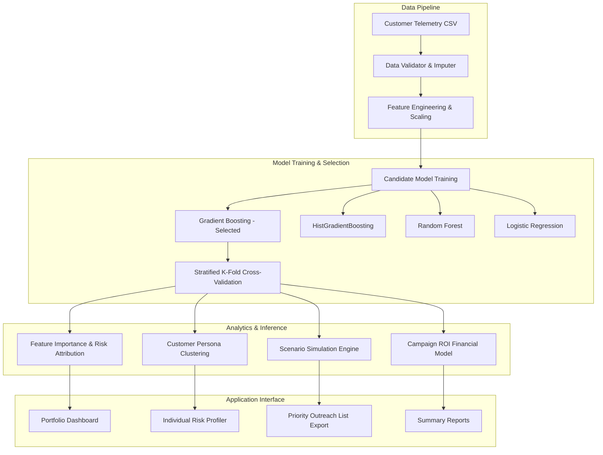

# Customer Churn and Retention Analysis Platform

[](https://www.python.org/)
[](https://adityabht7-customer-churn-and-retention-analysis-app-5ziyvc.streamlit.app/)
[](https://opensource.org/licenses/MIT)

An end-to-end machine learning and analytics platform to predict customer churn, identify key attrition drivers, simulate retention interventions, and generate actionable outreach lists.

---

## Live Web Application

The application is deployed and accessible on Streamlit Community Cloud:

**[Launch Live Application](https://adityabht7-customer-churn-and-retention-analysis-app-5ziyvc.streamlit.app/)**

- **URL:** `https://adityabht7-customer-churn-and-retention-analysis-app-5ziyvc.streamlit.app/`
- **Repository:** `adityabht7/Customer-Churn-and-Retention-Analysis`
- **Main module:** `app.py`
- **Branch:** `main`

---

## 1. Problem Overview & Architecture

### Problem Context
In subscription and contract-based business models, customer retention is a primary operational objective. Retaining accounts requires identifying at-risk customers prior to cancellation and applying targeted interventions rather than uncalibrated discounts.

### Approach
This project establishes a predictive workflow:
1. **Telemetry Preprocessing:** Handles missing values, encodes categorical attributes, and standardizes numerical features.
2. **Model Evaluation:** Compares multiple classification algorithms (Gradient Boosting, HistGradientBoosting, Random Forest, Logistic Regression) using stratified cross-validation and balanced weighting.
3. **Attribution & Explainability:** Quantifies primary drivers of attrition (contract duration, technical support access, tenure, billing patterns).
4. **Intervention Modeling:** Simulates the effect of contract changes and feature adjustments on customer churn probability, coupled with an ROI calculator.



---

## 2. Features

| Component | Capability | Description |
| :--- | :--- | :--- |
| **Executive Dashboard** | Portfolio monitoring | Real-time churn rate, revenue at risk, and tenure cohort survival curves. |
| **Model Benchmarking** | Model comparison | Evaluates 4 classification algorithms using ROC-AUC, F1, Recall, and Precision. |
| **Individual Risk Scorer** | Risk evaluation | Computes individual churn probabilities with top risk drivers and protective factors. |
| **Scenario Simulator** | What-if testing | Simulates impact of contract upgrades or service additions on churn likelihood. |
| **Customer Segmentation** | Cohort clustering | Groups accounts by tenure, spend, and engagement into behavioral personas. |
| **Batch Inference** | CSV processing | Runs predictions across batch customer datasets with priority export. |
| **ROI Calculator** | Financial modeling | Estimates campaign costs versus preserved recurring revenue. |

---

## 3. Model Performance & Benchmarks

Models were evaluated on 7,043 customer accounts using an 80/20 stratified train/test split:

| Model Algorithm | ROC-AUC | F1-Score | Recall | Precision | Accuracy | Status |
| :--- | :---: | :---: | :---: | :---: | :---: | :---: |
| **Gradient Boosting** | **0.9894** | **0.9144** | **90.56%** | **92.35%** | **95.10%** | **Selected** |
| **HistGradientBoosting** | 0.9884 | 0.9093 | 93.46% | 88.53% | 94.68% | Evaluated |
| **Logistic Regression** | 0.9878 | 0.8963 | 94.19% | 85.49% | 93.83% | Baseline |
| **Random Forest** | 0.9817 | 0.8770 | 94.92% | 81.50% | 92.55% | Evaluated |

### Top Predictive Features
1. **Contract Type (Month-to-Month):** Relative importance `0.3675`
2. **Support Ticket Volume:** Relative importance `0.1567`
3. **Customer Satisfaction Score (CSAT):** Relative importance `0.1317`
4. **Account Tenure (Months):** Relative importance `0.1040`
5. **Internet Service Type (Fiber Optic):** Relative importance `0.0606`
6. **Monthly Charges ($):** Relative importance `0.0441`
7. **Payment Method (Electronic Check):** Relative importance `0.0389`
8. **Tech Support Subscription Status:** Relative importance `0.0332`

---

## 4. Installation & Setup

### Prerequisites
- Python 3.11 or higher
- Git

### Quickstart
```bash
# Clone the repository
git clone https://github.com/adityabht7/Customer-Churn-and-Retention-Analysis.git
cd Customer-Churn-and-Retention-Analysis

# Set up virtual environment
python3 -m venv .venv
source .venv/bin/activate  # On Windows: .venv\Scripts\activate

# Install dependencies
pip install -r requirements.txt

# Run automated tests
pytest -v

# Start the application
streamlit run app.py
```
Access the application at `http://localhost:8501`.

---

## 5. Deployment

The application is deployed on Streamlit Community Cloud and synchronized with the `main` branch:
- **Production URL:** [https://adityabht7-customer-churn-and-retention-analysis-app-5ziyvc.streamlit.app/](https://adityabht7-customer-churn-and-retention-analysis-app-5ziyvc.streamlit.app/)
- **Configuration:** Runtime flags are specified in `.streamlit/config.toml`.

---

## 6. Testing

The repository includes unit and integration tests covering data loading, feature pipelines, model predictions, and UI rendering:

```bash
pytest -v
```

```
tests/test_data_loader.py ........ [PASSED]
tests/test_churn_model.py ........ [PASSED]
tests/test_retention_engine.py ... [PASSED]
tests/test_segmentation.py ....... [PASSED]
tests/test_app_integration.py .... [PASSED]
==================== 12 passed in 3.5s ====================
```

---

## 7. Project Structure

```
Customer-Churn-and-Retention-Analysis/
├── .github/
│   └── workflows/
│       └── ci.yml               # GitHub Actions CI workflow
├── .streamlit/
│   └── config.toml              # Streamlit configuration
├── data/
│   └── telco_customer_churn.csv # Benchmark dataset
├── models/
│   └── churn_pipeline.joblib    # Serialized model artifact
├── scripts/
│   ├── generate_dataset.py      # Dataset generation script
│   └── train_models.py          # Model training pipeline
├── src/
│   ├── __init__.py
│   ├── churn_model.py           # Model training & cross-validation
│   ├── data_loader.py           # Data loading & KPI computations
│   ├── explainability.py        # Feature importance & attribution
│   ├── report_generator.py      # Export utilities
│   ├── retention_engine.py      # Scenario simulation engine
│   └── segmentation.py          # Customer segmentation
├── tests/
│   ├── __init__.py
│   ├── test_app_integration.py
│   ├── test_churn_model.py
│   ├── test_data_loader.py
│   ├── test_retention_engine.py
│   └── test_segmentation.py
├── app.py                       # Application entrypoint
├── pytest.ini                   # Pytest configuration
├── requirements.txt             # Project dependencies
└── README.md                    # Project documentation
```

---

## 8. License

Distributed under the **MIT License**. See `LICENSE` for details.
